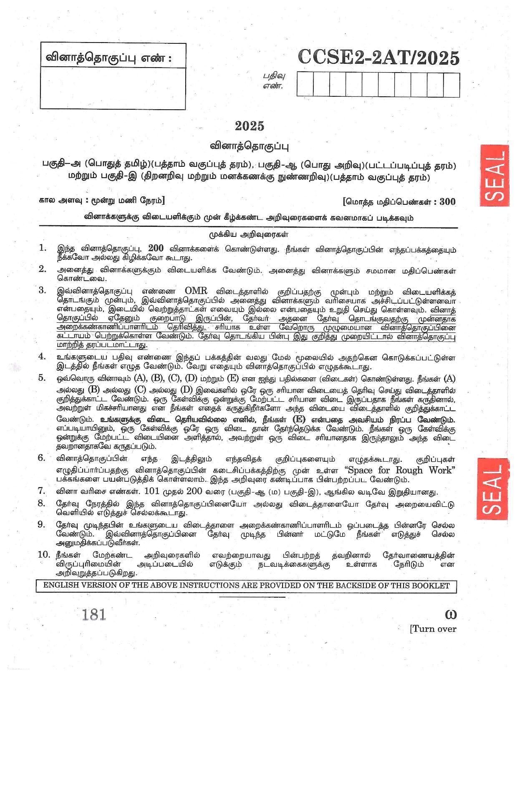

# TNPSC General Tamil Test Practice Platform (2012 - 2025)

A modern, responsive AWS-style examination and test practice platform for **TNPSC General Tamil (பொதுத் தமிழ்)**. Covering **38 complete question papers**, **999 original pages**, and **3,800+ questions** with marked answers and explanations.



---

## 🌟 Key Features

- **38 Official Question Sets (2012 to 2025)**: Including Group 2 / 2A, Group 4 / VAO, Subordinate Services, Executive Officer, and Technical exams.
- **Dual Examination Modes**:
  - **⏱️ Timed Mock Exam Mode**: Realistic exam simulation with 90/60 minute countdown timer, AWS-style 100-question navigation palette, and comprehensive score breakdown.
  - **📖 Practice / Study Mode**: Instant answer validation with marked answer reveals and explanatory solutions.
- **AWS Exam Status Palette**:
  - 🟢 Answered
  - 🔴 Unanswered / Visited
  - 🟣 Marked for Review
  - 🌸 Answered & Marked for Review
  - ⚪ Not Visited
- **High-Clarity Question Booklet Viewer**: View crisp, auto-rotated scans of original TNPSC exam papers with built-in zoom (+, -, reset) controls.
- **⭐ Bookmarks & ⚠️ Mistake Bank**: Automatically collects incorrect answers for focused revision; save tricky questions with one click.
- **Search & Year Filters**: Filter test papers by Year (2012–2025) or keyword search.
- **Dark / Light Mode**: Beautiful modern UI with full dark mode support.
- **Keyboard Shortcuts**: Option selection via `1-5` or `A-E`, `N` for next, `P` for previous, and `F` to flag.

---

## 📁 Project Structure

```
├── index.html        # Main application portal
├── css/
│   └── styles.css    # Modern UI styles, dark mode & responsive layouts
├── js/
│   ├── data.js       # Complete 38 sets database & question mappings
│   └── app.js        # Test engine, timer, palette & localStorage controller
├── assets/
│   └── pages/        # 999 optimized, high-resolution original question pages
└── README.md
```

---

## 🚀 Running Locally

You can run this project locally without any complex dependencies:

1. Double click `index.html` to open directly in any browser.
2. Or serve it via Python:
   ```bash
   python -m http.server 8080
   ```
   Open `http://localhost:8080` in your web browser.

---

## 🌐 Free Hosting on GitHub Pages

1. Create a new repository on GitHub: [github.com/new](https://github.com/new).
2. Push this project to GitHub:
   ```bash
   git init
   git add .
   git commit -m "Initial commit: TNPSC General Tamil Test Platform"
   git branch -M main
   git remote add origin https://github.com/<YOUR_USERNAME>/<YOUR_REPO_NAME>.git
   git push -u origin main
   ```
3. Go to **Settings** > **Pages** in your GitHub repository.
4. Under **Branch**, select `main` and root `/`, then click **Save**.
5. Your website will be live in 1 minute at:
   `https://<YOUR_USERNAME>.github.io/<YOUR_REPO_NAME>/`
